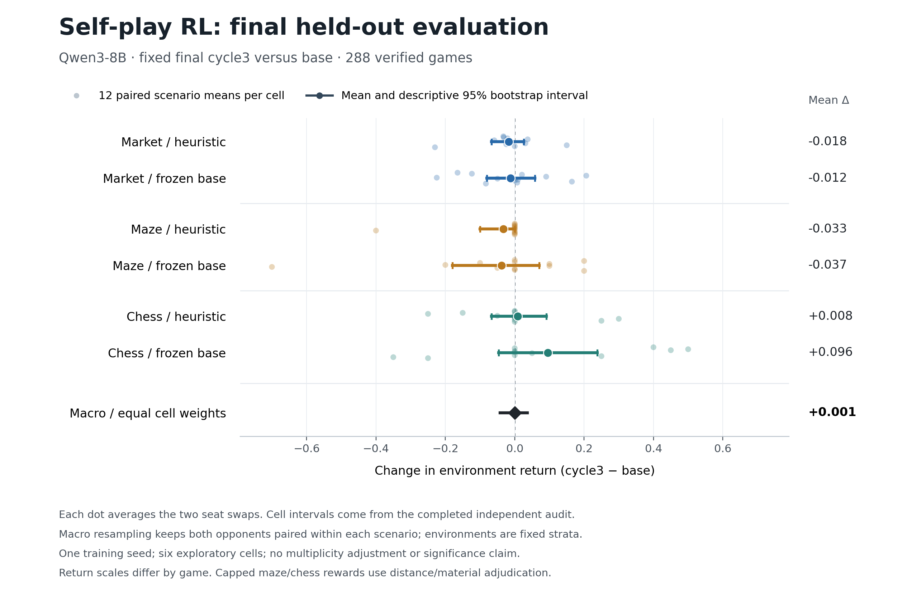
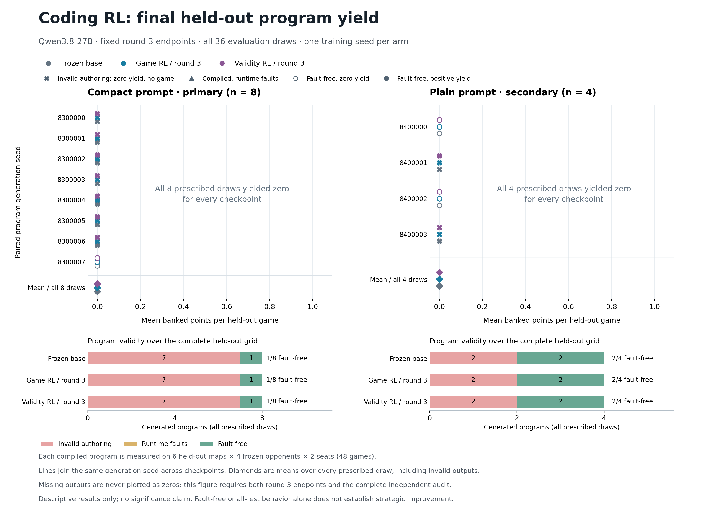

# Self play research results October 22 2026

The project now has a working play → reinforcement learning → replay pipeline for a market, a maze race, chess endgames and a programmable resource game. Real model weights changed, and the completed experiments passed independent replay and provenance audits. **This pilot did not demonstrate a reliable improvement in game performance.** It establishes the experimental machinery and identifies obstacles to a useful learning curriculum.

## Measured results

| Experiment | Completed work | Measured outcome |
| --- | --- | --- |
| Qwen3 8B game suite | 246 FP32 games, including two new training cycles with 88 optimizer minibatches each; separate 288-game final holdout | Final holdout mean return changed from −0.298178 to −0.297624. Difference +0.000553; descriptive paired-scenario 95% bootstrap interval [−0.041921, +0.036646]. No reliable gain. |
| Qwen3.8 27B compact coding pilot | One RLOO update over 3,191 completion tokens | The single evaluated program was token-identical before and after, banked zero points, and averaged −0.519608 relative return. |
| Qwen3.8 27B controlled coding study | Three updates per arm, six total, over 39,480 completion tokens; all 36 prescribed evaluation outputs | Gameplay rewards and validity-only rewards both produced zero held-out banked yield. Each trained endpoint generated the same completion tokens as base for every paired evaluation seed. |

The [final game holdout audit](../runs/arena-final-holdout-v1/analysis.json) verifies 288 episodes and 3,079 policy decisions. Its uncertainty calculation preserves both seats and opponent conditions within each scenario. There are 12 scenario clusters per environment, three fixed environments and one training run; the six individual cell intervals also include zero.

The [controlled coding audit](../runs/program-study-v1/final-audit.json) verifies both fixed final checkpoints, all evaluation outputs and all 12 validation/holdout cells. Each arm started from the same zero-update adapter and optimizer, used the same compact prompt and frozen opponent pool, and received three groups of eight freshly sampled programs. One arm used gameplay plus candidate-runtime-validity rewards; the other used validity alone. Successful API-written answers were not gradient targets.

| Evaluated checkpoint | Fault-free compact programs | Fault-free plain programs | Mean held-out banked yield |
| --- | --- | --- | --- |
| Base | 1 of 8 | 2 of 4 | 0 |
| Gameplay RL after three updates | 1 of 8 | 2 of 4 | 0 |
| Validity RL after three updates | 1 of 8 | 2 of 4 | 0 |

For each checkpoint, five compact outputs reached the unchanged 1,024-token limit and two failed the bounded Python interface. The sole fault-free compact controller always rested. The two fault-free plain controllers also banked no points. All paired yield differences are therefore zero. This result does not establish equivalence between training objectives or show that self-play cannot work.

The sampling units are **eight compact and four plain program draws per checkpoint**, not individual games. Each compiled program faced six held-out maps, four fixed opponents and both seats. Nine compiled evaluation programs produced 432 held-out game measurements; invalid authoring produced no fictional games but remained in the prescribed yield denominator at zero. Including validation gives 720 evaluation game measurements. Training supplied 288 game measurements and opponent calibration supplied another 42; the CPU audit verified 426 distinct replay records after deduplication. The [research summary](../runs/program-study-v1/final-research-summary.json) preserves these denominators and exact checkpoint identities.

## What the failures tell us

**The coding interface is a substantial bottleneck.** During opponent formation, three of eight fresh programs truncated and four completed programs produced invalid movement. One fresh controller qualified alongside one historical controller. A rejected near-miss banked 119 points across six calibration games but made two invalid moves. This is evidence of some strategic capability alongside unreliable action construction; simply increasing output length would not repair all observed failures. The [pool diagnosis](../runs/program-study-pool-diagnosis-v1.json) preserves the failed attempts and first-fault examples.

**Most early reward separation concerned validity.** In the first training group, six programs were invalid and two were valid, with slightly different game returns. The two objectives produced nearly proportional advantages but different adapter updates. The [round-one diagnostic](../runs/program-study-round1-diagnostic-v1.json) distinguishes this optimization signal from evidence of better gameplay. Across the complete study, the weights and recorded token probabilities changed, yet the small paired evaluation sample did not change its generated code.

**The short game horizons rely heavily on proxy rewards.** In the final holdout, 52 of 96 maze games ended by distance adjudication and 85 of 96 chess games by material adjudication. Each candidate reached the maze goal once in 48 games; neither achieved checkmate. Mean absolute market P&L fell from −6.9375 for base to −8.72917 for the final model in simulator units. Relative competitive return is not absolute profitability. See the [game-quality summary](../runs/arena-final-holdout-v1/research-quality-summary.json).

The original BF16 run remains incomplete after its likelihood discrepancy. Its first update and failed attempt are preserved. The separately named FP32 continuation completed successfully. Plain 27B coding also stopped at its four-attempt capability gate without training. These failures have not been relabeled or silently retried. The earlier compact pilot's inherited “two draws/three maps” caveat is incorrect: its actual evaluation used one draw, one map, three opponents and both seats.

## Visualizations and reproducibility

The project retains frozen source archives, prompts, schedules, sampled token probabilities, reward records, adapter and optimizer checkpoints, and failed attempts. The audits replay deterministic environments, verify hashes and actual optimizer tensors, and check recorded neural likelihood-gate results; they do not independently recompute neural likelihoods on CPU.

The interactive views remain separate so that authored controller revisions are not confused with trained model checkpoints:

- [FP32 game-suite Elo history](/Users/mitchellcatoen/.codex/visualizations/2026/10/20/01a15b4f-05a3-7053-9034-4d1bc9f8d726/arena-rating-history.html)
- [Market, maze and chess replays](/Users/mitchellcatoen/.codex/visualizations/2026/10/20/01a15b4f-05a3-7053-9034-4d1bc9f8d726/selfplay-arena.html)
- [Original programmable-game replays](/Users/mitchellcatoen/.codex/visualizations/2026/10/20/01a15b4f-05a3-7053-9034-4d1bc9f8d726/selfplay-program-arena.html)
- [Single-update coding RL replays](/Users/mitchellcatoen/.codex/visualizations/2026/10/20/01a15b4f-05a3-7053-9034-4d1bc9f8d726/coding-rl-replay.html)
- [Authored-controller tournament Elo](/Users/mitchellcatoen/.codex/visualizations/2026/10/20/01a15b4f-05a3-7053-9034-4d1bc9f8d726/controller-tournament-rating-history.html)

The 252-game authored-controller tournament measures fixed program versions, including older failures. The game-suite ratings are exploratory and use a separate arithmetic pool. Neither curve alone demonstrates improving general model capability. The controlled coding study used a frozen opponent pool, not an evolving training league. Existing context is in the [literature review](literature-review.md) and [research plan](research-plan.md).

## Cost and next decision

Known external API cost is **$0.234005378**. Conservative commitment, including the preserved ambiguous request and other upper bounds, is **$0.251194478**, against the **$100 cap**. Local neural training added no external inference or GPU-rental charges. No project cloud resource or cloud reservation was created. All neural jobs have exited. The accounting snapshot is [recorded separately](../runs/overnight-final-accounting-20261022.json).

The next experiment should first establish a reliable supply of valid, productive controllers. A fixed CPU corpus can expose action-contract failures at a target, at home with cargo, on an empty site, and at energy boundaries. A separately registered cardinal-action interface comparison could then test whether a simpler action vocabulary helps without changing gameplay. Preserve fresh sampling seeds and every failure, and do not repair selected model outputs after observing their scores.

Once that baseline is productive, a new fixed-budget training study can vary training strength or data volume and repeat across independent training seeds. Longer game horizons and actual goal completion should accompany an evolving opponent league. These are proposed follow-ups, not executed extensions of the completed studies. The present evidence supports a working research platform; dependable continual improvement remains the open question.
